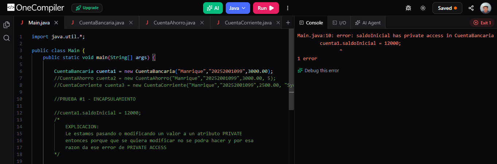
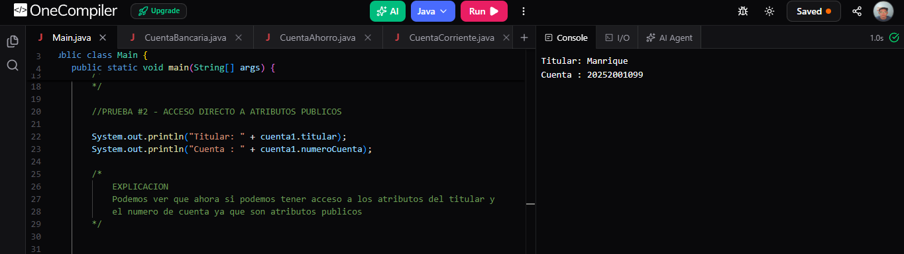
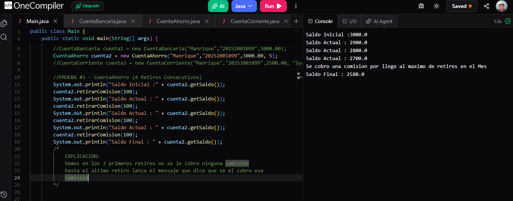
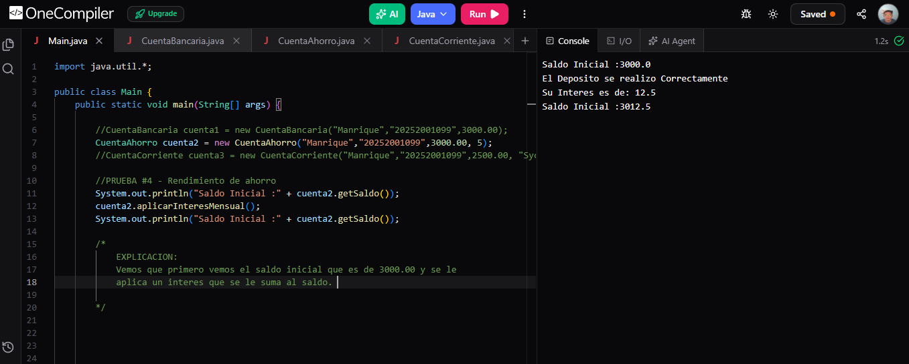
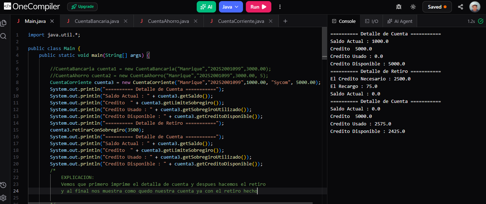
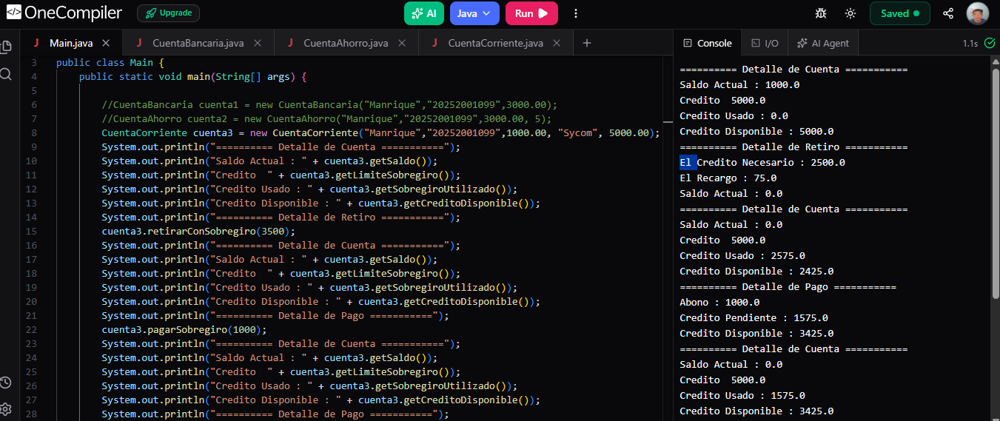
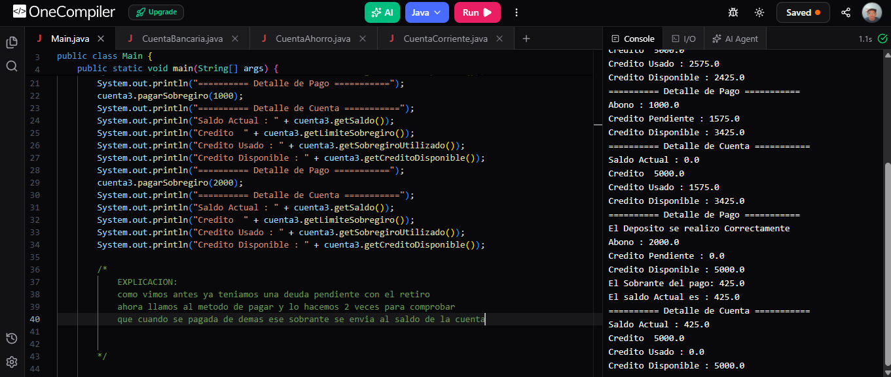

# POO-Proyecto-Banco-Manrique-Maher-Interiano-Mendez
simulador bancario en Java con encapsulamiento y herencia

## Datos del Estudiante
- **Nombre:** Manrique Maher Interiano Mendez
- **Cuenta:** 20252001099

## Descripcion del proyecto
Es un simulador bancaria en Java con encapsulamiento y herencia

### Clases
- `CuentaBancaria` Esta es la clase Base de una cuenta bancaria la cual protege el saldo con encapsulamiento y permite realizar ciertas acciones como: depositar, retirar y mostrar los datos de la cuenta.
- `CuentaAhorro` en esta clase hereda de `CuentaBancaria`, Agrega una tasa de interes anual, y cada vez que se llega a un maximo numero de retiros se cobra una comision, y se calcula un interes mensual. 
- `CuentaCorriente` en esta clase hereda de `CuentaBancaria`, permite tener un credito y con ese credito poder retirar dinero apensar de no tener suficiente dinero en la cuenta, y cuenta con un metodo de pagar la deuda.
- `Main` En esta clase se muestras las 6 Pruebas que se realizan para cada clase y verifica que todo funciona bien.

## Pruebas en cada Clase

### Prueba #1 - Encapsulamiento
En la primera prueba vemos que queremos cambiar el saldo de la cuenta ya inicializado y nos da error desde la consola ya que el atributo de saldo esta en modo private

### Prueba #2 Acceso directo a atributos publicos
Aqui podemos ver que mostramos en pantalla los atributos publicos como el nombre del `titular` y `numeroCuenta` y se muestran en la consula

### Prueba #3 CuentaAhorro y comision por exceso de retiros
Aqui vemos que el usuario hace 3 retiros de manera normal cada retiro es de 100 lps y se va descontando de su saldo pero cuando llega al 4 retiro vemos que se cobro un excedente y esa es la comision por exceso de retiros en el mes.

### Prueba #4 Rendimiento de ahorro con interes mensual
Aqui vemos que en el saldo actual tenemos 3000 lps pero cuanto ejecutamos el metodo de `aplicarInteresMensual()` vemos que nos da un valor de 12.5 y se suma en nuestro saldo ahi vemos que se ejecuta el metodo de interes mensual.

### Prueba #5 CuentaCorriente y retiro con sobregiro
Vemos al inicio de la consola que nos muestra a detalla nuestra cuenta de banco con nuestros datos y cuando realizamos un retiro que supera nuestro saldo de la cuenta toma parte del credito que tenemos y a ese monto se se suma un recargo y alfinal se actualiza la cuenta.

### Prueba #6 Amortizacion de la deuda de sobregiro
Como vimos en el anterior imagen vimos que despues de hacer un retiro pues tenemos una deuda con un recargo que tenemos que pagar, y aqui viene el metodo de `pagarSobregiro()` donde le ingresamos el monto y dependiendo del monto que le ingresemos pues va hacer diferente como si abonas pues solo se cancela una parte de la deuda pero el credito sube, si se paga completo pues se cancela la deuda pero si se paga de demas de la deuda el sobrante va al saldo de al cuenta.

